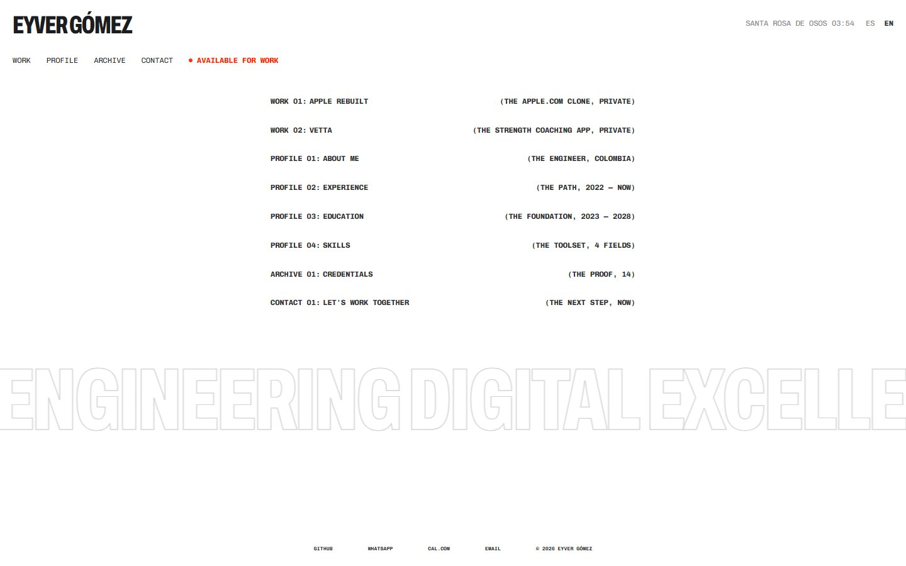
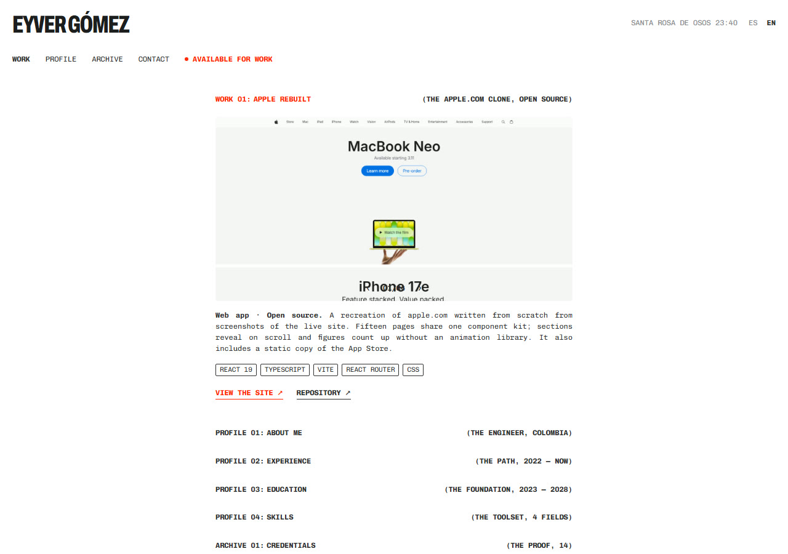
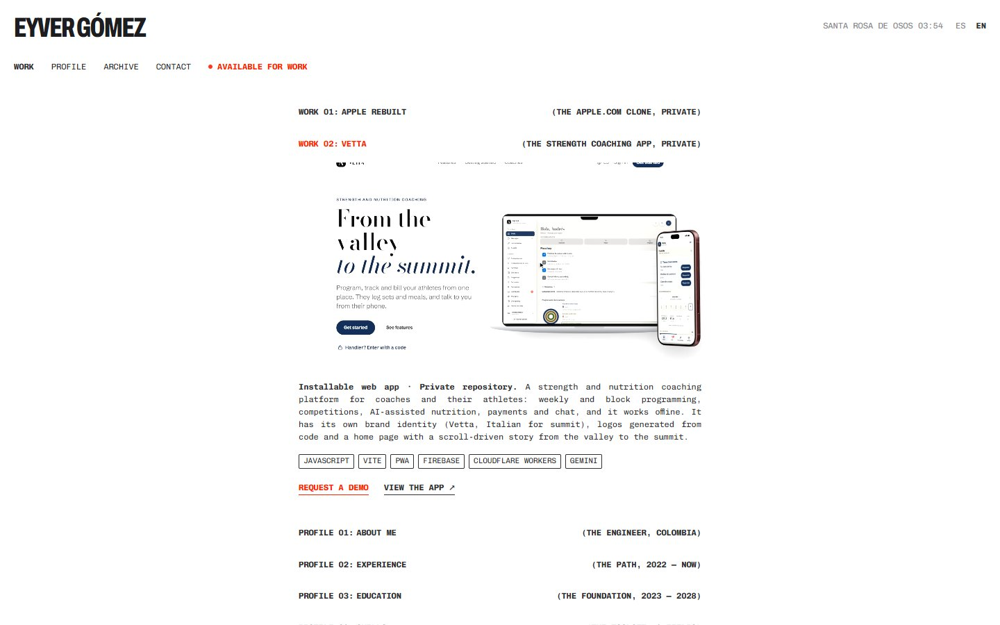
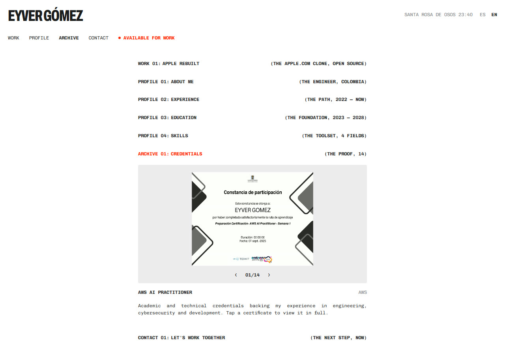
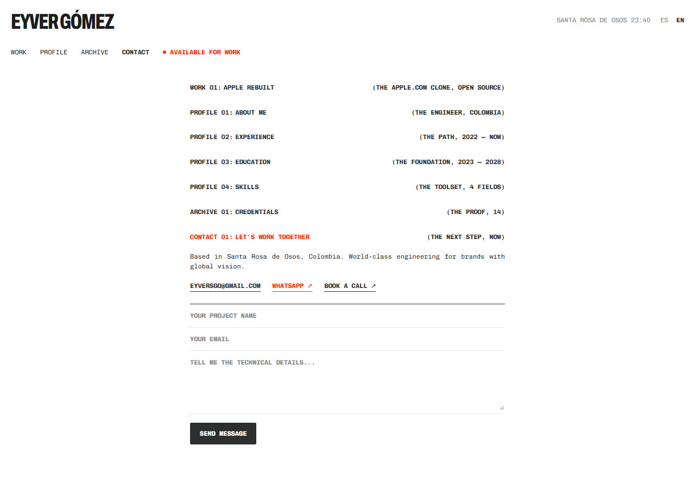

<h1 align="center">eyversgo.github.io</h1>

<p align="center">
  Portafolio personal de Eyver Gómez, ingeniero de software centrado en el diseño.
</p>

<p align="center">
  <a href="https://eyversgo.github.io/"><b>Sitio en vivo</b></a> ·
  <sub><a href="README.md">English</a> · Español</sub>
</p>

<p align="center">
  
</p>

<p align="center">
  
  
  
</p>

<p align="center">
  
</p>

## Resumen

Una sola página estática en HTML, CSS y JavaScript, sin paso de compilación. Cada sección se abre como una fila desplegable y tiene su propia URL limpia (`/apple-rebuilt`, `/about`, `/contact`). La página abre en inglés, y el selector ES/EN recuerda la elección del visitante.

| Sección | Ruta |
| :-- | :-- |
| Trabajo 01: Apple Rebuilt | `/apple-rebuilt` |
| Sobre mí | `/about` |
| Trayectoria | `/experience` |
| Formación | `/education` |
| Habilidades | `/skills` |
| Credenciales | `/certificates` |
| Contacto | `/contact` |

GitHub Pages sirve una copia de `index.html` desde la carpeta de cada ruta, y `404.html` cubre cualquier otra dirección.

## Ejecutarlo en local

En Windows, haz doble clic en **`start.bat`**. Sirve la carpeta en `http://127.0.0.1:5500/` y la abre en el navegador. Usa Python si está instalado y, si no, Node.js.

En cualquier sistema:

```sh
git clone https://github.com/eyversgo/eyversgo.github.io.git
cd eyversgo.github.io
python -m http.server 5500
```

## Publicación

El repositorio se publica con GitHub Pages desde la rama `main`. Cada push actualiza el sitio.
